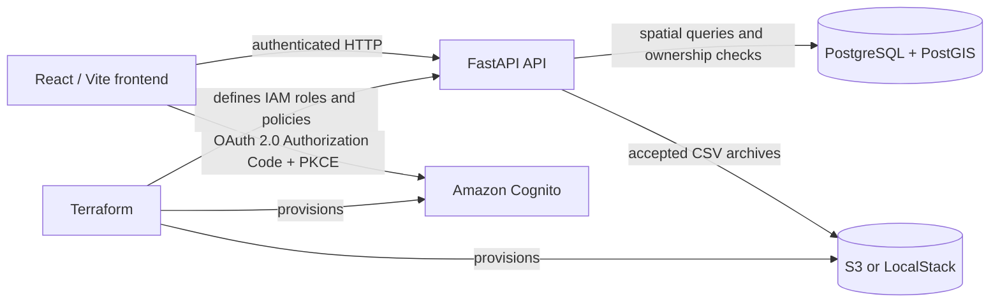

# Soil Pipeline Architecture

## Purpose

Soil Pipeline is a demonstration application for collecting, locating, and reviewing soil test results. It is designed to show full-stack ownership across data modeling, spatial queries, authentication, authorization, infrastructure as code, testing, and operational readiness.

The project is intentionally usable without a cloud deployment. Local Docker Compose is the primary demo environment, while Terraform defines the AWS services needed for a future deployment.

## System overview

## Components

### Frontend

The frontend is a React and TypeScript application built with Vite. It provides:

- Map-based sample visualization with Leaflet.
- Measurement-based marker coloring and location reports.
- CSV batch upload and single-sample entry.
- Owned-sample management, sharing, editing, archiving, and restoration.
- Cognito sign-in through the backend OAuth callback flow.

The development server proxies API and authentication requests to the local FastAPI service. The production build produces static assets and does not require Node.js at runtime.

### API

The API is a FastAPI application running on Python 3.11. Pydantic schemas validate incoming data before persistence. Routes are grouped around samples, reports, uploads, authentication, and health checks.

The API enforces access at the route and data-query layers:

- Cognito sessions establish the authenticated principal.
- Scope checks distinguish read, write, and batch-upload operations.
- Sample owners can edit, share, archive, restore, or delete their samples.
- Shared users receive viewer or editor access.
- Reference/demo records without an owner remain readable but are not editable.
- Archived samples are excluded from normal map and report queries.

### Database

PostgreSQL with PostGIS stores soil results, upload batches, provenance, parties, and sample-sharing records. A geographic point and GiST index support location-based reports and map queries.

Alembic is the source of truth for schema migrations. The current ownership and archive behavior is represented by the sample ownership and archiving revisions.

### Object storage

Accepted CSV batches are archived in an S3-compatible bucket. Local development uses LocalStack; a deployed environment can use Amazon S3. The bucket is private, encrypted at rest, versioned, transitions current objects to S3 Glacier Flexible Retrieval after 7 days, and expires noncurrent versions after 30 days. Glacier objects may need to be restored before retrieval.

Uploads persist a durable archive intent in PostgreSQL before writing to S3. Each intent has a unique generation and a two-hour lease. Finalization is a conditional database transition requiring the same generation, a pending state, and an unexpired lease, which fences stale upload workers from overwriting newer decisions. Reconciliation locks expired pending intents, records `archive_fenced_at` and `archive_fence_reason`, and deletes only objects that are then confirmed stale and unreferenced. A late S3 PUT cannot participate in the database transaction; a fenced worker cannot finalize it, and a later reconciliation pass handles any object left behind.

### Authentication and authorization

The application supports a lightweight API-key provider for local testing and Amazon Cognito for the OAuth-enabled demo flow. Cognito uses a public web client with the authorization-code flow and PKCE. The API validates the authenticated session and applies route scopes and sample-level authorization.

IAM is split by purpose:

- The Terraform permission set provisions the project’s Cognito, S3, IAM, and optional EKS Pod Identity resources.
- The API workload role is restricted to listing, writing, and deleting batch objects under the `soil-batches/` prefix.
- A permissions boundary limits the maximum permissions of the API workload role.

No EKS cluster is provisioned by this repository. The optional Pod Identity association is disabled by default and only applies to an existing cluster.

## Environments

### Local demo

Docker Compose runs:

- FastAPI
- PostgreSQL/PostGIS
- LocalStack S3
- React/Vite separately from the `frontend` directory

This environment is the lowest-cost and most reproducible way to demonstrate the application.

### AWS foundation

Terraform currently provisions:

- Cognito user pool, managed login domain, resource server, and OAuth client.
- Private versioned S3 batch archive bucket.
- API IAM role, policy, and permissions boundary.
- Terraform deployer customer-managed policy.
- An optional EKS Pod Identity association, disabled by default.

Terraform does not currently provision compute, a production database, a VPC, a container registry, or a load balancer. These are intentionally deferred to avoid creating a continuously running environment for a portfolio demo.

## Future deployment direction

If a live demonstration is needed, the application should be deployed as a short-lived environment using a managed container target and managed PostgreSQL/PostGIS. The deployment should add:

1. A container registry and image publishing job.
2. Application compute, such as ECS/Fargate or another managed container service.
3. Managed PostgreSQL/PostGIS.
4. Network and secret-management resources.
5. HTTPS ingress and a frontend hosting strategy.
6. GitHub Actions OIDC authentication with a narrowly scoped deployment role.

EKS is not required for the application and is intentionally outside the current deployment plan.

## Key decisions

| Decision | Rationale |
| --- | --- |
| Docker Compose for the default demo | Keeps the project inexpensive and easy to run in an interview or review. |
| PostGIS for location data | Makes spatial filtering and radius reports explicit rather than approximating geography in application code. |
| Cognito OAuth with PKCE | Demonstrates a realistic browser authentication flow without putting client secrets in the frontend. |
| Owner and shared-user authorization | Shows data-level access control beyond simply authenticating a user. |
| Soft archive before hard delete | Preserves operational history and makes accidental removal recoverable. |
| Terraform for the AWS foundation | Makes cloud configuration reproducible without requiring a live production environment. |
| CI validation without deployment | Provides automated confidence without storing AWS deployment credentials or incurring hosting costs. |

