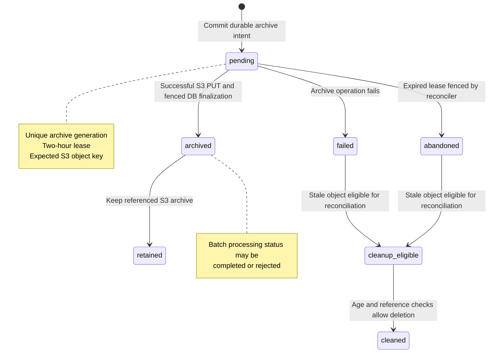

# Archive State Machine

The `archive_status` field tracks the lifecycle of the original CSV archive. It is separate from the batch processing `status` (for example, `completed` or `rejected`).

## State diagram

> **Interpretation:** `retained`, `cleanup_eligible`, and `cleaned` are explanatory diagram nodes, **not** values stored in the `archive_status` column. The persisted archive statuses shown here are `pending`, `archived`, `failed`, and `abandoned`.

## Persisted states

| `archive_status` | Meaning | S3 handling |
| --- | --- | --- |
| `pending` | A durable intent exists; an uploader may still be working. | Preserve while the lease is active. An expired lease can be fenced. |
| `archived` | Final database transition succeeded. | Preserve the referenced archive. |
| `failed` | The archive operation failed or was reported as failed. | Cleanup may remove a stale object after checks. |
| `abandoned` | Reconciliation fenced an expired pending intent. | Cleanup may remove the stale archive after checks. |

## Fencing rules

A finalizing uploader must satisfy **all** of the following conditions:

- The batch is still `pending`.
- Its `archive_generation` matches the uploader's generation.
- Its `archive_lease_until` is later than the finalization time.

The database transition to `archived` uses a conditional SQL `UPDATE`. If it affects zero rows, the transaction rolls back and the uploader returns HTTP 409. The uploader does **not** overwrite an existing terminal archive state.

The reconciler locks an expired pending batch row, refreshes its ORM state while holding the lock, and records `archive_fenced_at` and `archive_fence_reason` when marking it `abandoned`.

## Why cleanup is asynchronous

A database transaction cannot atomically commit or roll back an S3 PUT. Even after a lease is fenced, a late PUT could complete. The reconciliation job therefore periodically scans the configured S3 prefix, checks database references and lease state, and deletes eligible old objects. This provides eventual cleanup without claiming cross-system atomicity.

See also: [CSV Upload and Reconciliation Flow](CSV%20Upload%20and%20Reconciliation%20Flow.md) · [Diagram index](Home.md)
