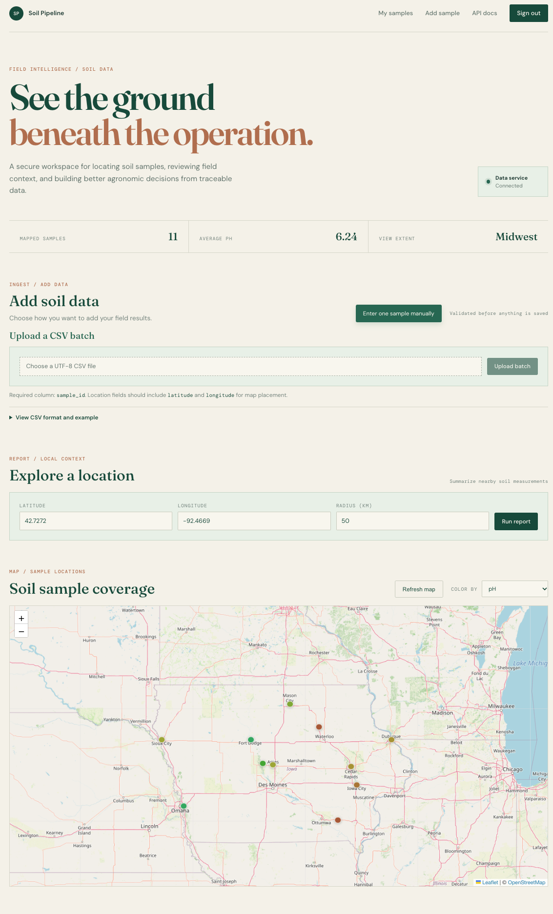
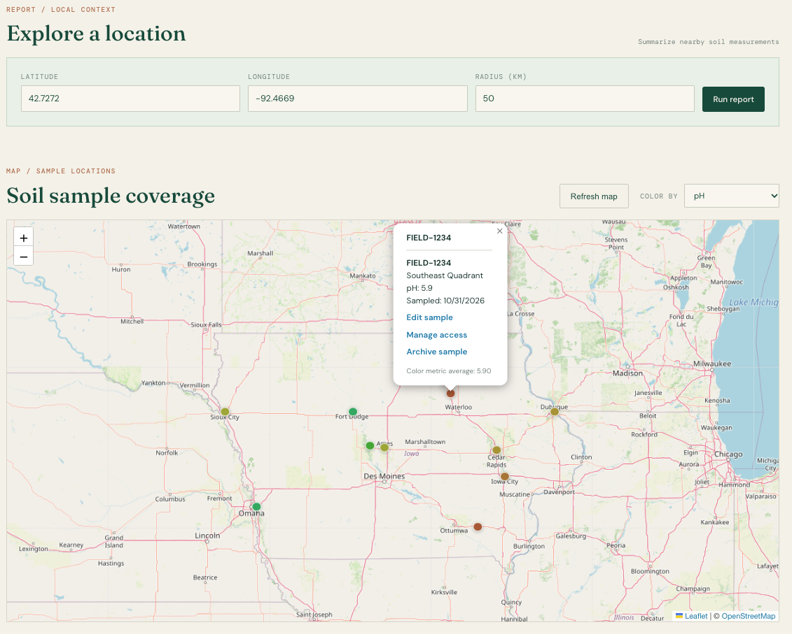
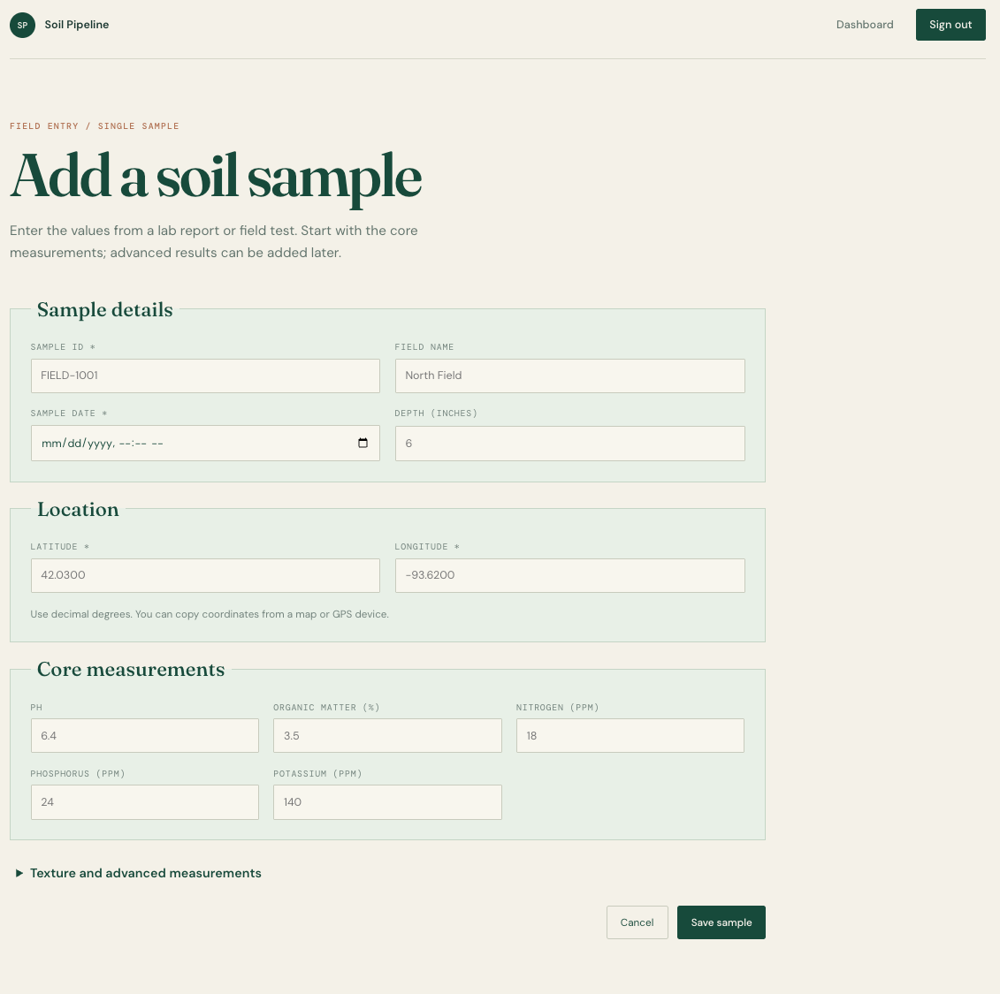
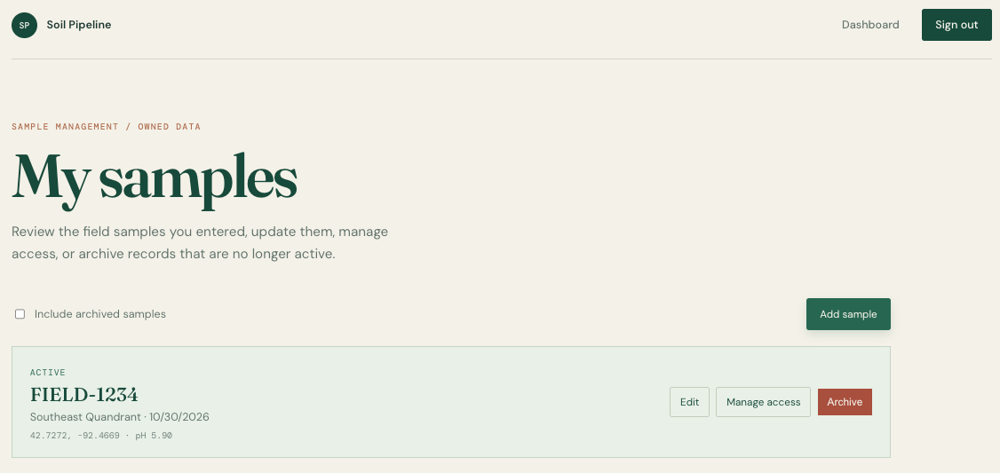
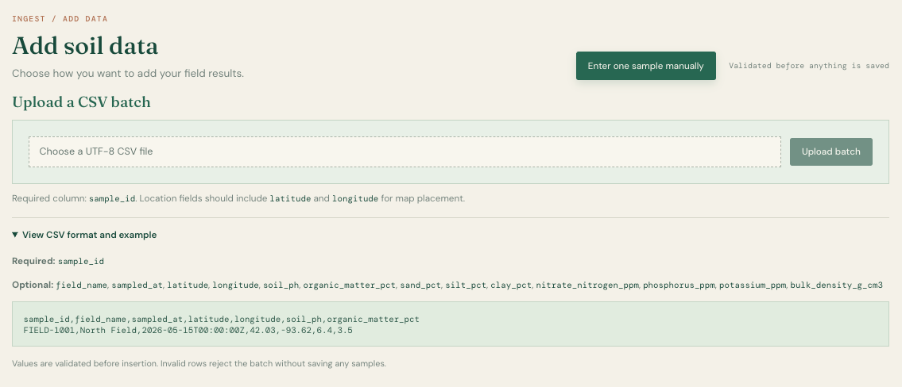

# Product screenshots

These screenshots show the primary Soil Pipeline workflow using sanitized demo data. They are intended to give a hiring manager a quick product-level view before they run the project.

## Dashboard and map

The authenticated dashboard shows the connected data service, sample summary metrics, CSV upload entry point, location reporting, measurement selection, and the map view.

## Marker details

The marker popup connects a mapped sample to its measurements and exposes owner actions for editing, sharing, and archiving.

## Manual sample entry

The form supports core measurements, coordinates, sampling date, depth, and expandable advanced texture fields.

## Owned sample management

The management view lists active samples entered by the signed-in user. Archived records can be included and restored from the same page.

## CSV upload

The upload view documents the required `sample_id` column, optional measurements, and the example CSV format before a batch is submitted.

## Screenshot checklist

Before adding or replacing a screenshot, confirm that it:

- Uses fictional or attributed demo data.
- Does not show personal email addresses or names.
- Does not show AWS account IDs, Cognito identifiers, tokens, cookies, or secrets.
- Does not include unrelated browser tabs, hover tooltips, or local filesystem paths.
- Is captured at a readable desktop width and cropped to the application where practical.

The source data shown on the map is documented in [`data/seed/README.md`](../../data/seed/README.md).
